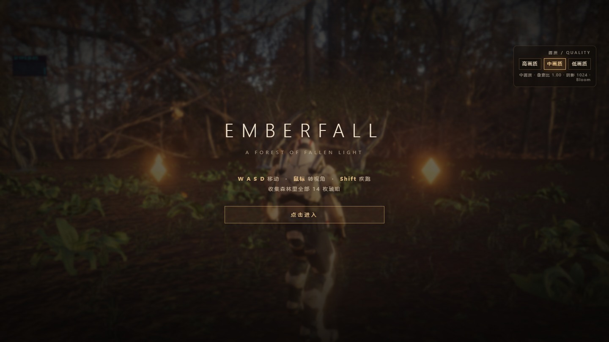

# Emberfall 鈥?3D Web Demo

涓€涓敤 **Three.js r168** 鎵嬫悡鐨勭涓変汉绉?3D 缃戦〉灏忔父鎴忥細榛勬槒妫灄閲屾敹闆?14 鏋氱惀鐝€銆?


## 鐜╂硶

- `W A S D` 绉诲姩锛岄紶鏍囪浆瑙嗚锛宍Shift` 鐤捐窇锛宍Esc` 鏆傚仠
- 鏀堕泦妫灄涓叏閮?14 鏋氬彂鍏夌惀鐝€锛岄泦榻愬悗缁撶畻
- 鍙充笂瑙掑彲閫夌敾璐細楂?/ 涓紙榛樿锛? 浣庯紝鎴栨寜 `1` `2` `3`

## 鎶€鏈爤

| 妯″潡 | 瀹炵幇 |
|---|---|
| 娓叉煋 | Three.js r168锛堟湰鍦?vendor锛屾棤 CDN 渚濊禆锛夈€丄CES Filmic 鑹茶皟鏄犲皠銆乻RGB 杈撳嚭 |
| 鍏夌収 | Poly Haven HDRI锛圥MREM 棰勫嵎绉級+ 瀹氬悜鍏?+ PCFSoft 闃村奖 |
| 鍚庢湡 | EffectComposer锛歎nrealBloom锛堝崐鍒嗚鲸鐜囷級+ OutputPass + 鑷啓 FXAA/璋冭壊鍗?pass |
| 鍦烘櫙 | 瀹炰緥鍖栨爲鏈?钑ㄧ被/鑽変笡锛岄《鐐归鍦猴紙onBeforeCompile 娉ㄥ叆锛夛紝钀藉彾涓庡皹鍩冪矑瀛?|
| 鐜╂硶 | 绗笁浜虹О鐩告満銆丮ixamo 瑙掕壊 Idle/Walk/Run 娣峰悎銆佸渾褰㈢鎾炴帹鍑恒€佹嬀鍙栧垽瀹?|
| 璋冭瘯 | stats.js FPS 闈㈡澘 + 涓夋。鐢昏川瀹炴椂鍒囨崲 |

## 鐩綍缁撴瀯

```
index.html            鍏ュ彛锛坕mportmap 鎸囧悜鏈湴 vendor锛?src/main.js           娓叉煋鍣ㄣ€佸厜鐓с€佸惊鐜€佺敾璐ㄥ垏鎹?src/world.js          鍦伴潰/妞嶈/绮掑瓙/鏍戝疄渚嬩笌椋庡満
src/player.js         瑙掕壊鎺у埗銆佺浉鏈恒€佸姩鐢荤姸鎬佹満銆佺鎾?src/collectibles.js   鐞ョ弨瀹炰緥鍖栦笌鎷惧彇绮掑瓙
src/post.js           鍚庢湡绠＄嚎
src/audio.js          鐜闊充笌闊虫晥
assets/               HDRI銆佹ā鍨?.glb)銆丳BR 璐村浘銆侀煶棰戙€佹巿鏉冩竻鍗?vendor/three/         Three.js 鍙婄敤鍒扮殑 addons锛堢绾垮彲鐢級
tools/                鏈湴闈欐€佹湇鍔″櫒涓庢埅鍥?绠€鍖栬剼鏈?```

## 杩愯

```bash
node tools/serve.mjs          # http://127.0.0.1:8177
```

鎴栧弻鍑?`鍚姩Emberfall.bat`锛堣嚜鍔ㄨ捣鏈嶅姟骞舵墦寮€娴忚鍣級銆?
## 绱犳潗鎺堟潈

鍏ㄩ儴绱犳潗涓?CC0 鎴?Mixamo 鍏嶈垂鍟嗙敤鎺堟潈锛屾潵婧愯 [assets/LICENSES.md](assets/LICENSES.md)銆?